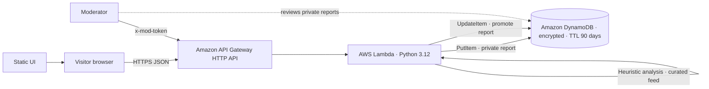

# ScamTrace

**Signal over noise.** ScamTrace is a serverless scam-intelligence MVP that helps people inspect suspicious URLs and messages, submit private community reports, and explore illustrative threat-pattern examples — all without opening or fetching any submitted link.

> **Demo status:** Threat indicators are **synthetic sample data**, not live intelligence. Analysis is transparent heuristics, not a reputation database or ML model. No AWS deployment has been performed from this workspace.

---

## What it does

| Feature | Detail |
|---------|--------|
| **URL and message screening** | 15 explainable risk signals plus a basic link-presence signal, including URL shorteners, punycode / homoglyph domains, IP-address URLs, suspicious TLDs, brand-subdomain mismatches, urgency language, payment lures, and credential requests. No URL is fetched or resolved. |
| **Risk labelling** | High / Medium / Low with a 0–100 score, per-signal explanations, plain-English safety advice, and a mandatory advisory disclaimer. |
| **Community reports** | Anonymous submission, server-side category validation, automatic redaction of common emails and phone-number-like strings, 90-day TTL, private storage only. Raw text is never returned by public endpoints. |
| **Threat indicator feed** | 8 synthetic sample records clearly marked SAMPLE with type, risk, confidence, source, first-seen, last-seen, report count, and review status. Searchable, filterable, and paginated. |
| **Moderation console** | Token-authenticated interface (constant-time comparison) for reviewing pending reports, dismissing duplicates, and promoting verified patterns into the public feed. Protected by `x-mod-token` header. |
| **Architecture page** | `/architecture.html` explains the data flow, privacy choices, and why S3 and Step Functions are excluded from this MVP. |

---

## Architecture



**API routes:**
- `POST /analyze` — heuristic URL / message screen (no fetch)
- `POST /reports` — private community report submission
- `GET  /signals` — curated public indicator feed (paginated, filterable)
- `GET  /moderate` — list pending reports (moderator token required)
- `POST /moderate` — take moderation action (token required)

**Why not S3?** Text-only MVP; no file upload. Adding storage before there is a need creates unnecessary sensitive-data handling surface.

**Why not Step Functions?** Analysis is a single fast synchronous request. Workflow orchestration adds complexity without benefit here.

---

## Project structure

```
├── public/
│   ├── index.html          # Single-page app (accessible, responsive)
│   ├── styles.css          # Design system (dark theme, design tokens)
│   ├── app.js              # All frontend logic + local analysis engine
│   ├── config.js           # API base URL (empty = local mode)
│   └── architecture.html   # Architecture explainer
├── src/
│   ├── analysis.py         # Heuristic analysis engine (15 risk signals)
│   └── handler.py          # Lambda handler (5 routes)
├── tests/
│   └── test_analysis.py    # 51 unit tests (all passing)
├── template/
│   └── template.yaml       # AWS SAM template (5 resources)
├── work/
│   └── check_template.py   # SAM YAML parse smoke-test
└── README.md
```

---

## Run locally

No build step, no Node.js toolchain required.

```powershell
# From the project root:
python -m http.server 4173 --directory public
# or:
npm start
```

Open `http://localhost:4173` in a browser.

**Without a deployed API:** the UI uses a browser-side heuristic fallback and the synthetic seed dataset. Backend-connected analysis uses the fuller Python ruleset. The report form clearly states that no data is sent.

**With a deployed API:** set `window.SCAMTRACE_API = 'https://YOUR_API_ID.execute-api.REGION.amazonaws.com'` in `public/config.js`, then serve the UI over HTTPS.

---

## Run tests

```powershell
python -m pytest tests/ -v
```

**51 / 51 tests pass** as of this version. Tests cover:

- Domain extraction, punycode detection, TLD matching, URL shortener detection, IP-URL detection, brand-subdomain mismatch
- Full `analyze()` output for high-risk URLs (shorteners, IP addresses, suspicious TLDs, brand mismatch), urgency messages, credential requests, advance-fee payment lures, benign text, and edge cases
- Score bounds (always 0–100), disclaimer presence, advice content
- `redact_personal_data()` for emails, phone numbers, UK mobiles, and false-positive prevention (years)

---

## Deploy backend with AWS SAM

### Prerequisites

- AWS CLI configured with a profile that can create API Gateway, Lambda, DynamoDB, IAM roles, and CloudFormation stacks
- AWS SAM CLI installed (`pip install aws-sam-cli` or via the official installer)
- Python 3.12 available locally for `sam build`

### Steps

**1. Generate a moderator token (keep it secret):**
```powershell
python -c "import secrets; print(secrets.token_urlsafe(32))"
```

**2. Build:**
```powershell
sam build --template-file template/template.yaml
```

**3. Deploy (guided, first time):**
```powershell
sam deploy --guided --template-file .aws-sam/build/template.yaml
```

You will be prompted for:
- `AllowedOrigin` — set to the HTTPS URL of your deployed frontend (e.g. `https://scamtrace.example.com`). **Do not leave as `*` in production.**
- `ModeratorToken` — the value from step 1. SAM marks this `NoEcho` so it is not logged.
- `LogRetentionDays` — how long to keep Lambda and API access logs (default 30).
- `ThrottleBurst` / `ThrottleRate` — API Gateway rate limits (defaults: 50 burst / 20 sustained).

When SAM asks whether to save deployment arguments to `samconfig.toml`, answer **No** so the moderator token is not written into a plaintext project config file. Keep the generated token in a password manager.

**4. After deployment:**
- Copy the `ApiUrl` from CloudFormation outputs.
- Set it in `public/config.js`: `window.SCAMTRACE_API = 'https://...';`
- Deploy the `public/` directory to an HTTPS static host (e.g. S3 + CloudFront, Netlify, Vercel).
- Verify endpoints manually with `curl` before announcing.

### What is deployed

| Resource | Purpose | Key settings |
|----------|---------|-------------|
| `ScamTraceApi` (HTTP API) | Public API | CORS locked to `AllowedOrigin`, throttled |
| `ReportsTable` (DynamoDB) | Private report storage | PAY_PER_REQUEST, encrypted at rest, PITR, 90-day TTL |
| `ScamTraceFunction` (Lambda) | All route handling | arm64, 256 MB, 10 s timeout, least-privilege IAM, reserved concurrency 20 |
| `ApiAccessLogGroup` | API Gateway access logs | Structured JSON, no request bodies, configurable retention |
| `ScamTraceFunctionLogGroup` | Lambda logs | JSON format, configurable retention |

### Deployment has NOT been run from this workspace

No AWS credentials are present here. All functionality described above is implemented and validated locally. The remaining step is `sam build && sam deploy --guided` with valid AWS credentials and a chosen `AllowedOrigin`.

---

## Demo flow (~90 seconds)

1. **Overview** — open the dashboard. Point out the sample-data notice and stat cards (analysis rules, data retention).
2. **Analyze: URL** — click **Fake delivery notice**. It auto-fills and runs. Walk through the signals: contains a link, security keywords in domain, suspicious TLD. Note the score, risk badge, and advice.
3. **Analyze: Message** — click **Urgent bank text**. Walk through: urgency language, brand mention, embedded link.
4. **Threat feed** — search `delivery`, filter to Medium risk. Show the SAMPLE badge and the note that these are synthetic examples, not confirmed threats.
5. **Report form** — submit: *"SMS claiming a parcel is held, asking for a small redelivery fee."* No personal details. Show the local-demo response explaining no data was sent.
6. **Close** — show the privacy note in the sidebar and the architecture page. Emphasize: results are advisory, links are never opened, reports are private until reviewed.

---

## Current limits (honest)

| Limit | Detail |
|-------|--------|
| Synthetic indicators | The 8 feed records are illustrative examples using `.example` domains. No live threat intelligence is integrated. |
| Heuristic analysis | Rule-based pattern matching, not a reputation database or ML model. A low score is not proof of safety. |
| No deployment | Backend has not been deployed from this workspace. |
| No live moderation | The moderation console is fully implemented but requires a deployed API and a configured `MODERATOR_TOKEN`. |
| No rate limiting per IP | The SAM template sets API Gateway throttling limits but not per-IP rate limiting. For production, consider AWS WAF. |
| No file upload | Text only. S3 would be added only if file evidence is a confirmed requirement. |
| No external threat feeds | Adding an external feed requires documented source licensing, privacy review, and failure-behavior specification. |
