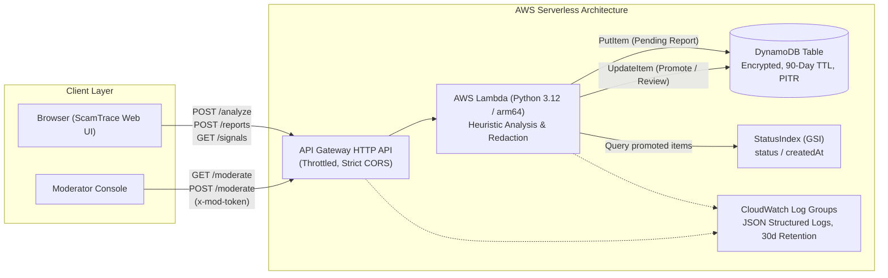

# ScamTrace — Project Submission & Architecture Overview

## 1. Problem Statement
Every day, thousands of individuals receive suspicious SMS messages, phishing emails, and deceptive links impersonating banks, postal services, or payment providers. Most victims lack a quick, safe way to check whether an incoming message or URL exhibits known threat patterns without inadvertently visiting the site or leaking personal details.

Existing anti-abuse tools typically require fetching/resolving the link (which tips off the attacker or exposes the user to drive-by exploits), submitting raw personal data to third-party databases, or complex account setups.

**ScamTrace** solves this problem by providing a private, community-oriented scam intelligence MVP:
1. **Zero-fetch screening:** Evaluates URLs and messages strictly via heuristics and pattern analysis—never fetching, querying DNS for, or visiting the submitted URL.
2. **Privacy-first community reporting:** Strips common emails and phone numbers before storing reports in an encrypted, 90-day expiring DynamoDB store.
3. **Credible intelligence pipeline:** Reports remain private until reviewed by moderators. Only verified patterns are promoted to the public threat indicators feed.

---

## 2. What We Built

### Client-Side Experience (`public/`)
- **Interactive Single-Page Application:** Built with accessible semantic HTML, keyboard-navigable focus indicators, skip-to-content accessibility, and responsive CSS (mobile, tablet, desktop).
- **Dual-Mode Analysis:** Analyzes URLs and SMS/email messages. Works completely offline via client-side heuristics and connects seamlessly to the backend when `window.SCAMTRACE_API` is configured.
- **Clear, Advisory Risk Communication:** Results are categorized as **High**, **Medium**, or **Low** risk with transparent contributing signal lists, practical defensive advice, and an explicit disclaimer stating that a low score does not guarantee safety.
- **Searchable Indicator Feed:** Seeded with 8 realistic synthetic examples (using `.example` domains and template descriptions). Includes type filtering, risk filtering, text search, and pagination.
- **Moderation Console:** A dedicated, token-authenticated interface for moderators to inspect pending submissions (with redacted content only), approve them, dismiss duplicates, or promote verified indicators into the public threat feed.

### Serverless Backend (`src/` & `template/`)
- **Amazon API Gateway (HTTP API):** Route-level throttling (20 req/s sustained, 50 req/s burst), strict CORS locked to the authorized HTTPS frontend, access logging with non-sensitive request metrics.
- **AWS Lambda (Python 3.12, arm64):**
  - `POST /analyze`: Heuristic pattern matching (punycode, shorteners, IP hosts, abuse TLDs, brand-subdomain mismatch, urgency, credential solicitations, payment lures).
  - `POST /reports`: Validates categories and inputs, auto-redacts personal contact info, and writes to DynamoDB with a 90-day TTL.
  - `GET /signals`: Returns curated indicators combining seed examples and moderator-promoted records via DynamoDB Global Secondary Index (`StatusIndex`).
  - `GET /moderate` & `POST /moderate`: Protected with constant-time token verification (`hmac.compare_digest`), enabling review, dismissal, or promotion.
- **Amazon DynamoDB:**
  - Encrypted at rest (SSE-S3/AWS-managed KMS).
  - Point-in-Time Recovery (PITR) enabled.
  - Automatic record expiration after 90 days (`ttl`).
  - `StatusIndex` Global Secondary Index on `status` and `createdAt` for fast querying of promoted indicators and pending moderation queues.

---

## 3. Architecture Diagram



---

## 4. Test Verification Summary

The test suite contains **57 automated tests** (all passing):
- **51 tests in `tests/test_analysis.py`:**
  - URL normalization and domain extraction.
  - Punycode detection (`xn--`).
  - Raw IP address hostname detection.
  - Known URL shortener matching (`bit.ly`, `tinyurl.com`, etc.).
  - High-risk TLD identification (`.xyz`, `.top`, `.click`, etc.).
  - Brand-in-subdomain spoofing detection (e.g. `paypal.update-account.com`).
  - Urgency and account intimidation phrasing.
  - Advance-fee and payment lure multi-match weighting.
  - Credential and PIN solicitations.
  - Personal data redaction (email and telephone numbers).
- **6 integration tests in `tests/test_handler.py` (via `moto`):**
  - `test_analyze_url`: API analysis execution and response format.
  - `test_analyze_validation_error`: Input validation guardrails.
  - `test_reports_submission_and_redaction`: DynamoDB persistence and auto-redaction.
  - `test_signals_returns_seed`: Seed indicator retrieval.
  - `test_moderate_auth_failure`: Rejection of missing/invalid moderator tokens.
  - `test_moderation_workflow_approve_and_promote`: End-to-end report submission, moderator review, indicator promotion, and appearance in `/signals`.

---

## 5. End-to-End Demo Script (< 3 Minutes)

| Time | Screen / Action | Talking Points |
| :--- | :--- | :--- |
| **0:00 - 0:30** | **Overview & Dashboard** | "Welcome to ScamTrace. One scam message reaches thousands; ScamTrace lets people spot warning signals safely. Notice that our threat indicators are clearly labeled as synthetic sample data—no unconfirmed claims." |
| **0:30 - 1:10** | **Analyze a Threat** | "Click 'Fake delivery notice'. ScamTrace flags urgency keywords, a suspicious domain ending, and fee mentions—scoring it 45/100 (High Risk). Crucially, the URL was never opened or resolved, protecting the user from exploits. Results are advisory only, directing users to verify through official channels." |
| **1:10 - 1:45** | **Community Reporting** | "Submit a synthetic report: *'SMS claiming a parcel is held, asking for a small redelivery fee'*. Point out: personal emails and phone numbers are automatically redacted before storage. Reports are kept private for 90 days and never published directly to the public feed." |
| **1:45 - 2:25** | **Moderation & Promotion** | "Log into the Moderation console using the moderator token. The pending report appears with the redacted description. A moderator can dismiss duplicates or promote verified patterns into the public feed with an indicator type and risk rating." |
| **2:25 - 2:50** | **Threat Intelligence Feed** | "Switch to Threat Intelligence. Search for our promoted indicator or filter by High Risk. Indicators clearly display their status, report counts, and whether they are community-reviewed or sample data." |
| **2:50 - 3:00** | **Wrap Up** | "Built serverless on AWS with API Gateway, Lambda, and DynamoDB with least-privilege IAM and privacy by default. Thank you." |

---

## 6. Deployment Guide & Status

### Workspace Deployment Status
- **Local Testing & Simulation:** 100% complete and verified with 57 automated tests.
- **AWS Deployment:** Not deployed from this workspace due to absence of configured AWS account credentials (`aws sts get-caller-identity` returns `NoCredentials`).

### Deployment Steps (When AWS Credentials Are Provided)
1. **Configure AWS Credentials:**
   ```powershell
   aws configure
   ```
2. **Generate a Strong Moderator Token:**
   ```powershell
   python -c "import secrets; print(secrets.token_urlsafe(32))"
   ```
3. **Build the SAM Application:**
   ```powershell
   sam build --template-file template/template.yaml
   ```
4. **Deploy Stack:**
   ```powershell
   sam deploy --guided
   # Parameters:
   # - AllowedOrigin: https://<your-frontend-domain> (e.g., CloudFront distribution or S3 HTTPS endpoint)
   # - ModeratorToken: <Token generated in Step 2>
   # - LogRetentionDays: 30
   ```
5. **Connect Frontend:**
   - Copy the output `ApiUrl` from CloudFormation.
   - Update `public/config.js`:
     ```javascript
     window.SCAMTRACE_API = 'https://<api-id>.execute-api.<region>.amazonaws.com';
     ```
   - Deploy `public/` to CloudFront + S3, Amplify, or any static HTTPS host.
